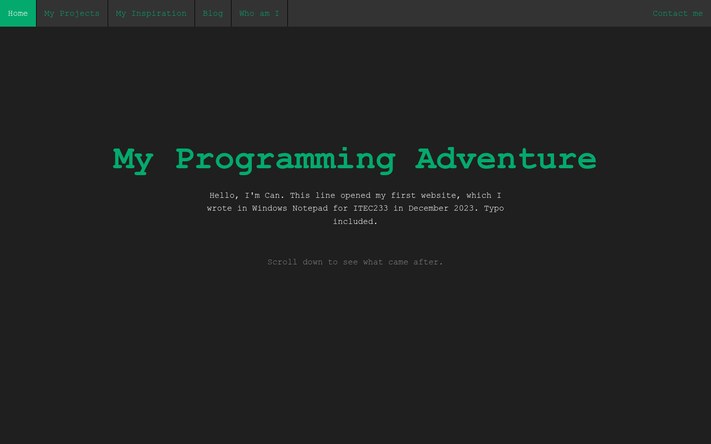
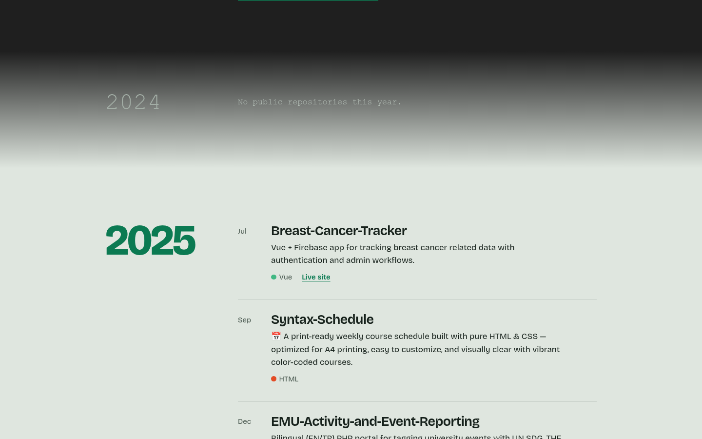

# My Programming Adventure

My first website: a small static personal blog built as the term project for the
**ITEC229** course (Fall 2023), plus a 2026 redesign that shows it next to what
came after.

- **Redesign:** https://contraill.github.io/Programming-Adventure/
- **Original 2023 site:** https://contraill.github.io/Programming-Adventure/2023/






## Early University Coursework

> The `2023/` folder is kept as an archive of early coursework. It is published
> as-is to show where I started, not as an example of current best practice.
> The `coursework-2023` tag points to the repository as first published.

I wrote every file by hand in **Windows Notepad**: no IDE, no framework, no
build step, no autocomplete. Typos such as "Proggramming" and the table-based
layout are left in on purpose.

What I learned while building it:

- **HTML structure:** pages, headings, paragraphs, ordered/unordered lists,
  images, links and relative paths between pages and folders
- **Layout with tables:** `<table>` + `<colgroup>` to build a three-column page
  (the pre-flexbox way I knew at the time)
- **Forms:** text inputs, a textarea and a button on the Contact page
  (front-end only, nothing is sent anywhere)
- **iframes and link targets:** the Inspiration page loads YouTube videos into
  one embedded frame via `target="iframe"`
- **CSS:** an external stylesheet, element/class/ID selectors, pseudo-classes
  (`:hover`, `:focus`, `:last-child`), a navigation bar, and a `@keyframes`
  slide-in animation
- **JavaScript basics:** `onload`, `setTimeout` and changing `style.display`
  through the DOM to show a loading screen before the page appears
- **Favicon** and a consistent colour theme across pages

## Pages (2023/)

| File | Content |
|------|---------|
| `2023/index.html` | Home |
| `2023/myprojects.html` | Small projects I had built (Python to-do list, C calculator, C ATM app, a DB design) |
| `2023/Inspiration.html` | Embedded YouTube lessons and videos |
| `2023/Blog.html` | A single blog post about starting to code |
| `2023/Whoami.html` | About me |
| `2023/Contact.html` | Contact form (static, not wired to a backend) |

## 2026 redesign

The root `index.html` is a single page that walks from the 2023 site to today:

- It opens in the original look (Consolas, `#04AA6D`, the old navbar, which still
  links to the `2023/` pages) and fixes the "Proggramming" typo on load.
- A timeline lists my public GitHub repositories by the year they were created,
  fetched live from the GitHub API, so new repos show up without editing the
  site. If the API is unreachable it falls back to `assets/repos.json`.
- The contact form opens your mail app with the message filled in (`mailto:`).

Still plain HTML, CSS and JavaScript with no build step.

## Running it

No install needed, but the redesign uses ES modules, so serve it over HTTP:

```sh
git clone https://github.com/Contraill/Programming-Adventure.git
cd Programming-Adventure
python3 -m http.server   # then open http://localhost:8000
node --test test/        # tests for the repo filtering and grouping
```

The original `2023/` pages also open fine by double-clicking.

## Third-party content

- Videos on the Inspiration page are YouTube embeds and belong to their creators.

## License

The code is released under the [MIT License](LICENSE). Third-party videos
listed above are not covered by it.
