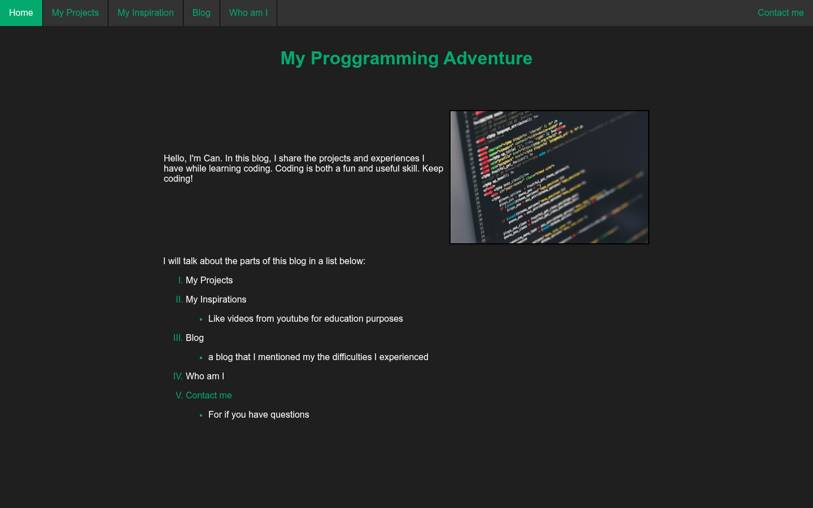
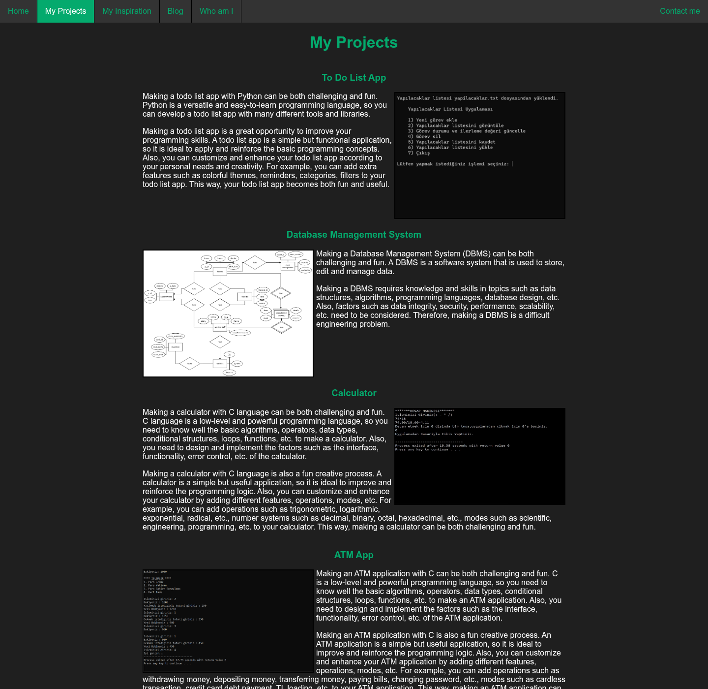

# My Programming Adventure

My first website: a small static personal blog built as the term project for the
**ITEC229** course (Fall 2023).

**Live demo:** https://contraill.github.io/Programming-Adventure/





## Early University Coursework

> This repository is kept as an archive of early coursework. It is published
> as-is to show where I started, not as an example of current best practice.

I wrote every file by hand in **Windows Notepad**: no IDE, no framework, no
build step, no autocomplete. Typos such as "Proggramming" and the table-based
layout are left in on purpose.

What I learned while building it:

- **HTML structure:** pages, headings, paragraphs, ordered/unordered lists,
  images, links and relative paths between pages and folders
- **Layout with tables:** `<table>` + `<colgroup>` to build a three-column page
  (the pre-flexbox way I knew at the time)
- **Forms:** text inputs, a textarea and a button on the Contact page
  (front-end only, nothing is sent anywhere)
- **iframes and link targets:** the Inspiration page loads YouTube videos into
  one embedded frame via `target="iframe"`
- **CSS:** an external stylesheet, element/class/ID selectors, pseudo-classes
  (`:hover`, `:focus`, `:last-child`), a navigation bar, and a `@keyframes`
  slide-in animation
- **JavaScript basics:** `onload`, `setTimeout` and changing `style.display`
  through the DOM to show a loading screen before the page appears
- **Favicon** and a consistent colour theme across pages

## Pages

| File | Content |
|------|---------|
| `index.html` | Home |
| `myprojects.html` | Small projects I had built (Python to-do list, C calculator, C ATM app, a DB design) |
| `Inspiration.html` | Embedded YouTube lessons and videos |
| `Blog.html` | A single blog post about starting to code |
| `Whoami.html` | About me |
| `Contact.html` | Contact form (static, not wired to a backend) |

## Running it

No install needed. Clone the repo and open `index.html` in a browser:

```sh
git clone https://github.com/Contraill/Programming-Adventure.git
cd Programming-Adventure
xdg-open index.html   # or just double-click it
```

## Third-party content

- Videos on the Inspiration page are YouTube embeds and belong to their creators.

## License

The code is released under the [MIT License](LICENSE). Third-party videos
listed above are not covered by it.
